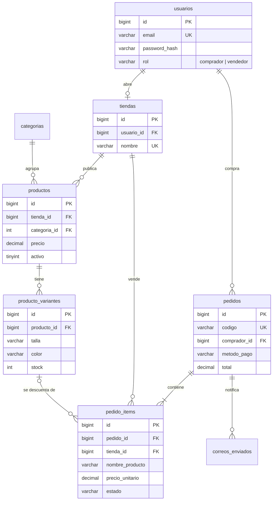

# JJ STORE · Marketplace de moda urbana

Proyecto de grado. JJ STORE es una tienda en línea donde **cualquier persona puede comprar y vender ropa**.
Tiene dos roles:

| Rol | Qué puede hacer |
|---|---|
| **Comprador** | Ver el catálogo, filtrar y buscar, ver tallas y colores disponibles, armar el carrito, pagar (simulado), recibir el correo de confirmación, seguir el estado de sus pedidos y editar su cuenta (nombre, celular y contraseña). |
| **Vendedor** | Tener su propia tienda, publicar/editar/ocultar/eliminar productos con foto, precio e inventario por talla y color, ver sus ventas, cambiar el estado del envío (el comprador recibe un correo) y ver un resumen con métricas. |

> El pago es **100 % simulado**: no se conecta a ningún banco ni se cobra dinero.

📘 **¿Vas a exponer o estás empezando?** Lee la [Guía para la exposición](docs/GUIA-EXPOSICION.md):
explica paso a paso qué se hizo, cómo funciona la carga de productos y la compra, dónde modificar el
diseño y el backend, y trae las preguntas que suele hacer el jurado con sus respuestas.

---

## Tecnologías

- **Frontend:** HTML5, CSS3 y JavaScript (sin frameworks).
- **Backend:** PHP 8.1+ (probado en 8.2 y 8.3) sin framework, con una API JSON.
- **Base de datos:** MySQL 8 o MariaDB 10.5+ (probado en MySQL 8.4 y MariaDB 11.4), acceso con PDO y sentencias preparadas.
- **Correo:** [PHPMailer](https://github.com/PHPMailer/PHPMailer) por SMTP (Gmail, Outlook, Mailtrap…) o modo "archivo" sin internet.
- **Paradigma:** programación estructurada y modular con apoyo de POO (backend), orientada a eventos y asíncrona (frontend); arquitectura cliente-servidor en 3 capas.

---

## Instalación

### Requisitos
- XAMPP, WAMP o Laragon con **PHP 8.1 o superior** y MySQL/MariaDB.
- No hace falta Composer: la librería de correo ya viene en `vendor/`.

### 1. Base de datos
En **phpMyAdmin** (`http://localhost/phpmyadmin`) → pestaña *Importar* → selecciona
**`database/jjstore.sql`** → *Importar*. Crea la base `jjstore` con sus 8 tablas y los datos de prueba.

O desde la terminal:
```bash
mysql -u root --default-character-set=utf8mb4 < database/jjstore.sql
```

> ⚠️ Importarlo borra y vuelve a crear las tablas. Sirve también para reiniciar la demo.
> `jjstore.sql` es la unión de `schema.sql` (estructura) y `datos-demo.sql` (datos).

### 2. Configuración (opcional)
Sin hacer nada, el sistema usa MySQL en `127.0.0.1:3306`, usuario `root` sin contraseña (lo de
WAMP/XAMPP). Si tu MySQL es distinto o quieres enviar correos reales, copia `.env.example` con el
nombre `.env` y ajusta los valores.

### 3. Abrir el sitio

**Opción A · WAMP / XAMPP:** copia la carpeta `JJSTORE` dentro de `www` (WAMP) o `htdocs` (XAMPP),
enciende Apache y MySQL, y abre
👉 `http://localhost/JJSTORE/`

**Opción B · Servidor de PHP:** desde la carpeta del proyecto:
```bash
php -S localhost:8000 -t public
```
👉 `http://localhost:8000`

---

## Cuentas de prueba

Contraseña de todas: **`Demo1234`** (en la página de inicio de sesión hay botones para entrar con un clic).

| Correo | Rol |
|---|---|
| `comprador@jjstore.test` | Comprador (ya tiene 4 pedidos) |
| `vendedor@jjstore.test` | Vendedor · tienda **JJ STORE Oficial** |
| `barrionorte@jjstore.test` | Vendedor · tienda **Barrio Norte Studio** |

### Tarjetas de prueba (pago simulado)

| Número | Resultado |
|---|---|
| `4242 4242 4242 4242` | ✅ Aprobada |
| `4000 0000 0000 0002` | ❌ Rechazada (fondos insuficientes) |

Cualquier fecha futura y cualquier CVV de 3 dígitos. También se puede pagar con **PSE** (simulado) o **contra entrega**.

---

## Correo de confirmación

Se envían tres tipos de correo:

1. **Compra** → al comprador, con el detalle del pedido.
2. **Nueva venta** → a cada vendedor que vendió algo en ese pedido, con los datos de envío.
3. **Cambio de estado** → al comprador cuando el vendedor marca el pedido como preparando, enviado, entregado o cancelado.

Todos quedan registrados en la tabla `correos_enviados`.

| `MAIL_DRIVER` en `.env` | Comportamiento |
|---|---|
| `archivo` (por defecto) | No sale nada a internet. En la página del pedido aparece el botón **VER CORREO** para mostrarlo. Ideal para sustentar sin conexión. |
| `smtp` | Envía correos reales. |

**Ejemplo con Gmail:**
1. Activa la verificación en 2 pasos de la cuenta.
2. Crea una contraseña de aplicación en <https://myaccount.google.com/apppasswords>.
3. En `.env`:
```ini
MAIL_DRIVER=smtp
MAIL_HOST=smtp.gmail.com
MAIL_PORT=587
MAIL_ENCRYPTION=tls
MAIL_USERNAME=tucorreo@gmail.com
MAIL_PASSWORD=la-contraseña-de-16-letras
MAIL_FROM_ADDRESS=tucorreo@gmail.com
MAIL_FROM_NAME="JJ STORE"
```
Para recibir la confirmación, regístrate con tu correo real (las cuentas demo usan `@jjstore.test`, que no existe).

---

## Recorrido para la sustentación

1. **Tienda:** filtra por categoría, busca "barrio norte", abre una prenda y elige color y talla (las tallas agotadas aparecen tachadas).
2. **Carrito:** agrega productos; la barra muestra cuánto falta para el envío gratis (desde $200.000). El carrito se conserva al recargar.
3. **Pagar:** sin sesión te lleva al login y luego regresa al checkout. Prueba primero la tarjeta rechazada y después la aprobada.
4. **Confirmación:** código del pedido + botón **VER CORREO**. El stock se descuenta en la base de datos.
5. **Vendedor:** entra con `barrionorte@jjstore.test`. En *Ventas* aparece el pedido nuevo. Márcalo como *Enviado*: el comprador recibe el correo y lo ve en *Mis pedidos*.
6. **Productos:** crea uno con foto, tallas, colores y stock por combinación; ocúltalo o edítalo.
7. **Registro:** crea una cuenta nueva eligiendo *Quiero vender*, o desde una cuenta de comprador usa *Vender en JJ STORE*.
8. **Mi cuenta:** en el menú del usuario cambia el nombre o el celular, y cambia la contraseña (pide la actual).

---

## Estructura del proyecto

```
JJSTORE/
├── public/                 ← única carpeta visible en el navegador
│   ├── index.html          tienda (catálogo, vista rápida, carrito)
│   ├── login.html          inicio de sesión
│   ├── register.html       registro (comprador o vendedor)
│   ├── checkout.html       envío y pago simulado
│   ├── pedido.html         confirmación / detalle de un pedido
│   ├── mis-pedidos.html    historial del comprador
│   ├── cuenta.html         mi cuenta (nombre, celular, contraseña)
│   ├── vendedor.html       panel de vendedor
│   ├── css/                style.css (tienda), login.css, panel.css
│   ├── js/                 api.js (compartido) + un archivo por página
│   ├── api/                endpoints PHP que responden JSON
│   │   ├── auth.php        sesión, registro, login, logout, abrir tienda, mi cuenta
│   │   ├── catalogo.php    categorías y productos
│   │   ├── pedidos.php     cotizar, comprar, mis pedidos, ver correo
│   │   └── vendedor.php    resumen, productos, ventas, tienda
│   └── uploads/productos/  fotos subidas por los vendedores
├── app/                    código del servidor (no accesible desde el navegador)
│   ├── bootstrap.php       arranque: configuración, errores, sesión
│   ├── config.php          lectura del archivo .env
│   ├── BaseDatos.php       conexión PDO
│   ├── http.php            respuestas JSON y errores
│   ├── Validador.php       validación de formularios
│   ├── auth.php            sesión, roles y protección CSRF
│   ├── catalogo.php        tallas, colores y consultas de variantes
│   ├── pedidos.php         carrito → pedido (transacción con bloqueo de stock)
│   ├── pagos.php           pasarela de pago simulada
│   ├── imagenes.php        subida segura de imágenes
│   ├── correo.php          envío con PHPMailer o modo archivo
│   ├── notificaciones.php  correos de compra, venta y cambio de estado
│   └── plantillas/         HTML de los correos
├── database/
│   ├── jjstore.sql         estructura + datos (importar este)
│   ├── schema.sql          solo la estructura
│   └── datos-demo.sql      solo los datos de prueba
├── tests/prueba-api.php    prueba automática de la API (50 verificaciones)
├── docs/                   guía para la exposición
├── vendor/                 librerías externas (PHPMailer)
├── storage/logs/           registro de errores de PHP
├── .env.example            plantilla de configuración
└── composer.json           dependencias (PHPMailer)
```

### Prueba automática

Con el sitio funcionando y la base recién importada:
```bash
php tests/prueba-api.php http://localhost/JJSTORE
```
Debe terminar en `TODO OK`. Como crea pedidos y productos de prueba, al terminar vuelve a importar
`database/jjstore.sql`.

---

## Modelo de datos



Decisiones importantes:
- **Inventario por variante:** cada combinación talla + color tiene su propio stock (`producto_variantes`).
- **Un pedido, varias tiendas:** un pedido puede incluir productos de distintos vendedores. Cada tienda solo ve y gestiona sus propios ítems y su estado (`pedido_items.tienda_id`).
- **Historial inmutable:** `pedido_items` guarda nombre, precio, talla y color del momento de la compra. Si el vendedor cambia el precio o borra el producto, el historial no cambia.
- **Estados del envío:** `nuevo → preparando → enviado → entregado`, o `cancelado` (devuelve las unidades al inventario).

---

## Seguridad aplicada

- Contraseñas con `password_hash` (bcrypt); nunca se guardan en texto plano.
- Todas las consultas usan **sentencias preparadas** (protección contra inyección SQL).
- **Precios calculados en el servidor:** el navegador solo envía qué producto y cuántas unidades; el precio y el stock se leen de la base de datos.
- **Bloqueo de inventario** (`SELECT … FOR UPDATE` dentro de una transacción): dos compradores no pueden llevarse la última unidad al mismo tiempo.
- **Protección CSRF:** cada petición POST exige un token de la sesión en el encabezado `X-CSRF-Token`.
- Cookie de sesión `HttpOnly` y `SameSite=Lax`; el id de sesión se regenera al iniciar sesión.
- **Control de acceso:** un vendedor solo puede ver y modificar productos y ventas de su tienda; un comprador solo ve sus propios pedidos.
- **Subida de imágenes:** se valida el tipo real del archivo (JPG/PNG/WEBP, máx. 2 MB), se renombra con un nombre aleatorio y la carpeta no ejecuta código.
- Todo texto del usuario se **escapa** antes de mostrarse (HTML y correos) para evitar XSS.
- No se guarda el número de tarjeta ni el CVV, solo la marca y los últimos 4 dígitos.
- El código del servidor, el `.env` y los scripts SQL están fuera de la carpeta pública.

### Mejoras posibles (fuera del alcance)
- Recuperación de contraseña por correo y límite de intentos de inicio de sesión.
- Integración con una pasarela real (Wompi, Mercado Pago, PayU).
- En producción, definir `APP_URL` en `.env` y usar HTTPS.

---

## API

Todas las respuestas tienen la forma `{ "ok": true, "datos": … }` o `{ "ok": false, "error": "…", "errores": { "campo": "…" } }`.

| Método | Ruta | Descripción | Acceso |
|---|---|---|---|
| GET | `api/auth.php?accion=sesion` | Usuario actual + token CSRF | Público |
| POST | `api/auth.php?accion=registro` | Crear cuenta | Público |
| POST | `api/auth.php?accion=login` | Iniciar sesión | Público |
| POST | `api/auth.php?accion=logout` | Cerrar sesión | Público |
| POST | `api/auth.php?accion=ser-vendedor` | Abrir una tienda | Usuario |
| POST | `api/auth.php?accion=actualizar-perfil` | Cambiar nombre y celular | Usuario |
| POST | `api/auth.php?accion=cambiar-password` | Cambiar la contraseña (pide la actual) | Usuario |
| GET | `api/catalogo.php?accion=categorias` | Categorías | Público |
| GET | `api/catalogo.php?accion=productos&categoria=&q=` | Productos con variantes | Público |
| POST | `api/pedidos.php?accion=cotizar` | Precios y stock actuales del carrito | Público |
| POST | `api/pedidos.php?accion=crear` | Pagar y crear el pedido | Usuario |
| GET | `api/pedidos.php?accion=mis-pedidos` | Historial | Usuario |
| GET | `api/pedidos.php?accion=detalle&codigo=` | Un pedido | Dueño |
| GET | `api/pedidos.php?accion=correo&codigo=` | Ver el correo de confirmación | Dueño |
| GET | `api/vendedor.php?accion=resumen` | Métricas de la tienda | Vendedor |
| GET | `api/vendedor.php?accion=productos` | Productos de la tienda | Vendedor |
| POST | `api/vendedor.php?accion=guardar-producto` | Crear / editar producto | Vendedor |
| POST | `api/vendedor.php?accion=estado-producto` | Mostrar / ocultar | Vendedor |
| POST | `api/vendedor.php?accion=eliminar-producto` | Eliminar | Vendedor |
| GET | `api/vendedor.php?accion=ventas&estado=` | Ventas de la tienda | Vendedor |
| POST | `api/vendedor.php?accion=estado-venta` | Cambiar estado del envío | Vendedor |
| GET/POST | `api/vendedor.php?accion=tienda` / `guardar-tienda` | Datos de la tienda | Vendedor |
