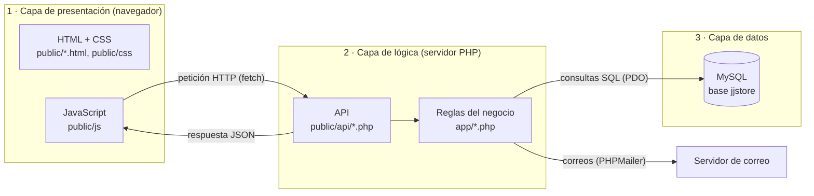
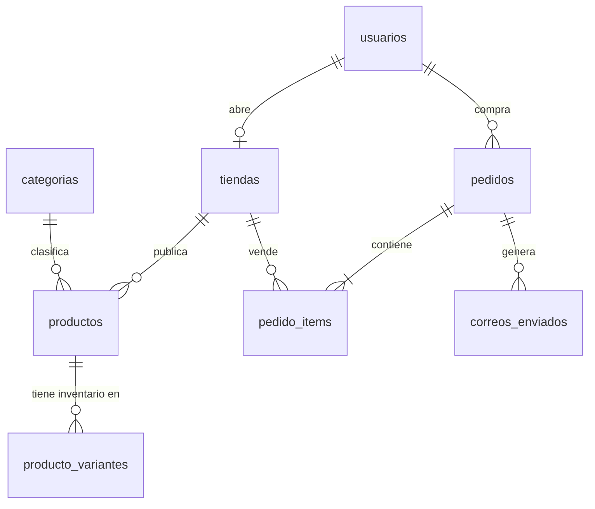
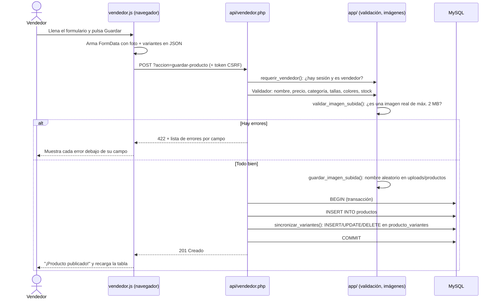
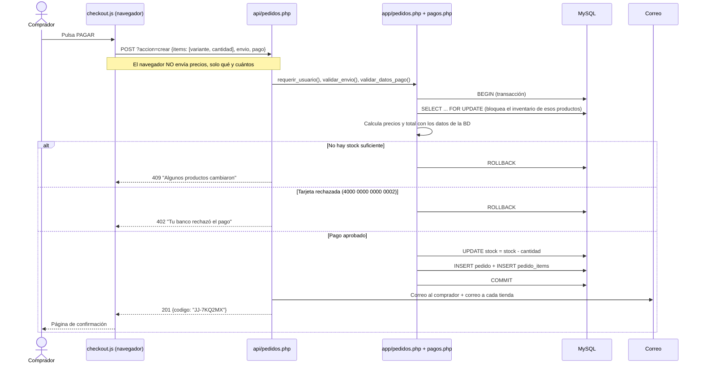
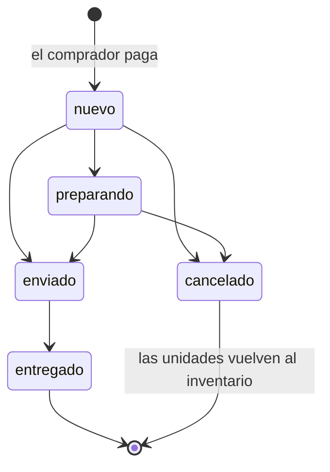

# Guía de JJ STORE para la exposición

Esta guía explica **qué es el proyecto, cómo está construido, cómo instalarlo y cómo defenderlo**.
Está escrita para alguien que está empezando a programar. Léela completa una vez y repasa las
secciones 3, 8, 9 y 15 antes de exponer.

## Contenido

1. [¿Qué es JJ STORE?](#1-qué-es-jj-store)
2. [Qué había al inicio y qué se construyó](#2-qué-había-al-inicio-y-qué-se-construyó)
3. [Ficha técnica (especificaciones del sistema)](#3-ficha-técnica-especificaciones-del-sistema)
4. [Arquitectura y "modo de programación"](#4-arquitectura-y-modo-de-programación)
5. [Estructura de carpetas](#5-estructura-de-carpetas)
6. [Cómo ponerlo a funcionar en tu computador](#6-cómo-ponerlo-a-funcionar-en-tu-computador)
7. [La base de datos explicada](#7-la-base-de-datos-explicada)
8. [Proceso de carga de productos (vendedor)](#8-proceso-de-carga-de-productos-vendedor)
9. [Proceso de compra (comprador)](#9-proceso-de-compra-comprador)
10. [Correos electrónicos](#10-correos-electrónicos)
11. [Seguridad, explicada fácil](#11-seguridad-explicada-fácil)
12. [Dónde modificar el diseño](#12-dónde-modificar-el-diseño)
13. [Dónde modificar el backend](#13-dónde-modificar-el-backend)
14. [Pruebas realizadas](#14-pruebas-realizadas)
15. [Guion sugerido para la exposición](#15-guion-sugerido-para-la-exposición)
16. [Preguntas que les pueden hacer (con respuestas)](#16-preguntas-que-les-pueden-hacer-con-respuestas)
17. [Glosario](#17-glosario)

---

## 1. ¿Qué es JJ STORE?

JJ STORE es una **tienda en línea de ropa urbana tipo marketplace**: no vende una sola marca, sino que
cualquier persona puede **abrir su tienda y vender**, y cualquier persona puede **comprar** productos de
todas las tiendas. Es como un "Mercado Libre" pequeño, especializado en moda.

El sistema tiene **dos roles**:

| Rol | Qué hace |
|---|---|
| **Comprador** | Navega el catálogo, filtra y busca, elige talla y color, arma su carrito, paga (de forma simulada), recibe un correo de confirmación y sigue el estado de sus pedidos. |
| **Vendedor** | Tiene su propia tienda. Publica productos con foto, precio e inventario por talla y color, recibe un correo cuando vende, gestiona el envío de sus ventas y ve métricas de su negocio. |

> **El pago es simulado.** No se conecta a un banco y no se cobra dinero. Funciona igual que una
> pasarela real (valida la tarjeta, aprueba o rechaza), pero todo ocurre dentro del sistema.

---

## 2. Qué había al inicio y qué se construyó

| Antes | Ahora |
|---|---|
| Solo el diseño visual (HTML y CSS). | Aplicación web completa con servidor y base de datos. |
| 8 productos escritos a mano dentro del JavaScript. | Productos guardados en MySQL; los vendedores los crean desde su panel. |
| Login y registro sin funcionar ("disponible próximamente"). | Cuentas reales con contraseña cifrada y dos roles (comprador / vendedor). |
| Carrito que se borraba al recargar. | Carrito guardado en el navegador y validado por el servidor. |
| "Comprar" mostraba un `alert()` con el resumen. | Checkout con envío y pago simulado (tarjeta, PSE o contra entrega). |
| Sin correos. | Correos de confirmación de compra, aviso de venta y cambio de estado. |
| No existía. | Panel de vendedor: resumen, productos, ventas y datos de la tienda. |
| No existía. | Historial de pedidos del comprador. |
| No existía. | Página **Mi cuenta**: cambiar nombre, celular y contraseña. |

También se corrigieron errores del diseño original:
- `index.html` cargaba `script.js`, pero el archivo se llamaba `java.js`, así que el catálogo no aparecía.
- El carrito tenía el atributo `inert` y nunca se le quitaba: sus botones no respondían.
- El menú de celular no tenía código para abrirse.
- El botón "Mostrar contraseña" del registro buscaba un campo que no existía.

---

## 3. Ficha técnica (especificaciones del sistema)

| Aspecto | Detalle |
|---|---|
| **Tipo de aplicación** | Aplicación web, arquitectura **cliente-servidor** en 3 capas. |
| **Lenguaje del frontend** (lo que ve el usuario) | **HTML5** (estructura), **CSS3** (diseño) y **JavaScript** moderno (ES2020+), **sin frameworks**. |
| **Lenguaje del backend** (servidor) | **PHP 8.2** (funciona desde PHP 8.0), **sin framework**. |
| **Base de datos** | **MySQL 8** o **MariaDB 10.4+** (la que trae XAMPP). Probado en MySQL 8.4 y MariaDB 11.4; con la MariaDB 10.4 de XAMPP no se probó directamente, pero solo usa funciones que MariaDB tiene desde la versión 10.2. Motor **InnoDB**, codificación **utf8mb4** (soporta tildes, ñ y emojis). |
| **Lenguaje de base de datos** | **SQL**. |
| **Servidor web** | **Apache 2.4** (incluido en WAMP y XAMPP) o el servidor integrado de PHP. |
| **Comunicación frontend ↔ backend** | **API** con peticiones HTTP que responden en formato **JSON**. |
| **Librerías externas** | **PHPMailer 6** para enviar correos por SMTP (Gmail, Outlook…). Se instala con **Composer** y ya viene incluida en la carpeta `vendor/`. |
| **Control de versiones** | **Git** + **GitHub**. |
| **Diseño** | Responsive (se adapta a celular, tableta y computador). Tipografías Montserrat y Poppins (Google Fonts). Imágenes de demostración de Unsplash. |
| **Navegadores** | Chrome, Edge, Firefox y Safari en versiones actuales. |
| **Herramientas para correrlo** | XAMPP, WAMP o Laragon, y un navegador. |

**Números clave para recordar:**

| | |
|---|---|
| Páginas | 8 (tienda, login, registro, checkout, pedido, mis pedidos, mi cuenta, panel de vendedor) |
| Tablas en la base de datos | 8 |
| Archivos de API | 4 (`auth`, `catalogo`, `pedidos`, `vendedor`) con 24 acciones en total |
| Tipos de correo | 3 (compra, nueva venta, cambio de estado) |
| Estados de un pedido | 5 (nuevo, preparando, enviado, entregado, cancelado) |
| Datos de demo | 2 tiendas, 18 productos, 122 combinaciones de talla y color, 4 pedidos |

---

## 4. Arquitectura y "modo de programación"

### 4.1 Arquitectura cliente-servidor en 3 capas



1. **Presentación:** el navegador muestra las páginas. JavaScript pide los datos al servidor y los
   pinta en pantalla.
2. **Lógica:** PHP recibe la petición, valida, revisa permisos, aplica las reglas del negocio
   (precios, stock, pagos, estados) y responde en JSON.
3. **Datos:** MySQL guarda usuarios, tiendas, productos, inventario, pedidos y correos.

> Analogía para explicarlo: el navegador es el **mesero**, PHP es la **cocina** y MySQL es la
> **despensa**. El cliente nunca entra a la cocina; solo hace pedidos al mesero.

### 4.2 ¿Qué "modo de programación" (paradigma) se usó?

El proyecto es **multiparadigma**. Cada parte usa el estilo que mejor le sirve:

| Parte | Paradigma | Dónde se ve |
|---|---|---|
| **Backend (PHP)** | **Programación estructurada / procedural modular**: el código está organizado en **funciones** agrupadas por tema en archivos (módulos). | `app/pedidos.php` tiene `cotizar()`, `crear_pedido()`…; `app/auth.php` tiene `requerir_vendedor()`… |
| **Backend (PHP)** | **Programación orientada a objetos (POO)** donde aporta: clases, encapsulamiento y herencia. | Clase `BaseDatos` (conexión), clase `Validador` (validar formularios), clase `ErrorApi` que **hereda** de `RuntimeException`. |
| **Frontend (JavaScript)** | **Programación orientada a eventos**: el código reacciona a lo que hace el usuario (clic, escribir, enviar formulario). | `boton.addEventListener("click", ...)` en todos los archivos de `public/js`. |
| **Frontend (JavaScript)** | **Programación asíncrona**: se pide información al servidor sin congelar la página. | `async` / `await` y `fetch()` en `public/js/api.js`. |
| **Base de datos** | **Programación declarativa (SQL)**: se dice *qué* datos se quieren, no *cómo* buscarlos. | `SELECT ... FROM productos WHERE activo = 1`. |

**Frase para responder:** *"Usamos un enfoque multiparadigma: en el backend, programación
estructurada y modular con funciones, apoyada en programación orientada a objetos para la conexión
a la base de datos, la validación y el manejo de errores; en el frontend, programación orientada a
eventos y asíncrona; y SQL, que es declarativo, para la base de datos. Todo bajo una arquitectura
cliente-servidor en tres capas."*

### 4.3 Patrones de diseño usados

| Patrón | Qué significa | Dónde |
|---|---|---|
| **Singleton** | Solo existe una conexión a la base de datos por petición, y se reutiliza. | `app/BaseDatos.php` |
| **Módulo** (JavaScript) | Todas las utilidades compartidas viven dentro de un solo objeto `JJ`, sin variables globales sueltas. | `public/js/api.js` |
| **Enrutador por acción** | Cada archivo de la API decide qué hacer según `?accion=...` con un `switch`. | `public/api/*.php` |
| **Plantillas (vistas)** | El HTML de los correos está separado de la lógica que los envía. | `app/plantillas/` |
| **Delegación de eventos** | Un solo "escuchador" en el contenedor atiende los clics de muchos botones creados dinámicamente. | `public/js/tienda.js`, `public/js/vendedor.js` |
| **Transacción (unidad de trabajo)** | Varias operaciones de base de datos se guardan todas o ninguna. | `crear_pedido()` en `app/pedidos.php` |

### 4.4 ¿Es MVC?

No se usó un framework MVC (como Laravel), pero **sí se respetó la misma separación de
responsabilidades**:

| MVC | En JJ STORE |
|---|---|
| **Modelo** (datos y reglas) | `app/*.php`: consultas SQL y reglas del negocio. |
| **Vista** (lo que se ve) | `public/*.html`, `public/css`, `public/js` y `app/plantillas` (correos). |
| **Controlador** (recibe la petición y decide) | `public/api/*.php`. |

**Frase para responder:** *"No usamos un framework MVC, pero la arquitectura está separada en
capas de forma equivalente: los endpoints de la API hacen de controladores, los archivos de `app/`
tienen el modelo y las reglas del negocio, y el frontend es la vista."*

### 4.5 ¿Es una API REST?

Es una **API HTTP que responde JSON, de estilo REST simplificado**: usa los métodos **GET** para
consultar y **POST** para modificar, códigos de estado HTTP (200, 201, 401, 403, 404, 422…) y no guarda
estado en el cliente más allá de la sesión. No es REST "estricto" porque las rutas usan el parámetro
`?accion=` (por ejemplo `api/vendedor.php?accion=productos`) en lugar de rutas como `/productos/5`.
Se hizo así para que funcione en cualquier Apache **sin configuración adicional**.

### 4.6 Orden en que se construyó (proceso de desarrollo)

Se trabajó de forma **incremental**, una capa a la vez, probando cada una antes de seguir:

1. **Análisis** del código existente y detección de errores.
2. **Diseño de la base de datos** (tablas, relaciones y datos de prueba).
3. **Backend**: núcleo (configuración, conexión, validación, sesiones) → servicios (catálogo, pagos,
   pedidos, correos) → API.
4. **Pruebas automáticas de la API.**
5. **Frontend**: conexión de la tienda a la API, login/registro, checkout, pedidos y panel de vendedor.
6. **Pruebas en navegador** (computador y celular) y corrección de detalles.
7. **Pruebas de compatibilidad** (Apache de WAMP con PHP 8.3, PHP 8.0 a 8.5, MySQL 8.4, MariaDB 11.4, envío SMTP).
8. **Documentación.**

---

## 5. Estructura de carpetas

**Regla de oro:** `public/` es lo único que ve el navegador. Todo lo demás es privado.

```
JJSTORE/
├── public/                  ← LO QUE VE EL NAVEGADOR (frontend + puerta de entrada de la API)
│   ├── index.html           Tienda: catálogo, vista rápida, carrito
│   ├── login.html           Iniciar sesión
│   ├── register.html        Crear cuenta (comprador o vendedor)
│   ├── checkout.html        Datos de envío y pago simulado
│   ├── pedido.html          Confirmación / detalle de un pedido
│   ├── mis-pedidos.html     Historial del comprador
│   ├── cuenta.html          Mi cuenta: editar nombre, celular y contraseña
│   ├── diagnostico.php      Revisa si al computador le falta algo para correr el proyecto
│   ├── vendedor.html        Panel de vendedor
│   ├── css/                 Diseño
│   │   ├── style.css        Tienda (colores principales, encabezado, tarjetas, carrito)
│   │   ├── login.css        Login y registro
│   │   └── panel.css        Checkout, pedidos y panel de vendedor
│   ├── js/                  Comportamiento de cada página
│   │   ├── api.js           Compartido: conexión con el servidor, sesión, carrito, utilidades
│   │   ├── tienda.js        index.html
│   │   ├── login.js         login.html
│   │   ├── registro.js      register.html
│   │   ├── checkout.js      checkout.html
│   │   ├── pedido.js        pedido.html
│   │   ├── mis-pedidos.js   mis-pedidos.html
│   │   ├── cuenta.js        cuenta.html
│   │   └── vendedor.js      vendedor.html
│   ├── api/                 Endpoints: reciben peticiones y responden JSON
│   │   ├── auth.php         Sesión, registro, login, logout, abrir tienda, editar cuenta
│   │   ├── catalogo.php     Categorías y productos
│   │   ├── pedidos.php      Cotizar carrito, comprar, mis pedidos, ver correo
│   │   └── vendedor.php     Resumen, productos, ventas, datos de la tienda
│   └── uploads/productos/   Fotos que suben los vendedores
│
├── app/                     ← EL "CEREBRO" (privado)
│   ├── bootstrap.php        Arranque: carga configuración, errores y sesión
│   ├── config.php           Lee el archivo .env; costo de envío
│   ├── BaseDatos.php        Conexión a MySQL (PDO)
│   ├── http.php             Respuestas JSON y errores
│   ├── Validador.php        Validación de formularios
│   ├── auth.php             Usuario actual, roles, protección CSRF
│   ├── catalogo.php         Tallas y colores permitidos
│   ├── pedidos.php          Carrito → pedido (transacción con bloqueo de stock)
│   ├── pagos.php            Pasarela de pago simulada
│   ├── imagenes.php         Subida segura de fotos
│   ├── correo.php           Envío de correos
│   ├── notificaciones.php   Qué correo se envía y a quién
│   └── plantillas/          Diseño HTML de los correos
│
├── database/                ← LA BASE DE DATOS
│   ├── jjstore.sql          Todo en un archivo (importar este)
│   ├── schema.sql           Solo la estructura (tablas)
│   └── datos-demo.sql       Solo los datos de prueba
│
├── tests/prueba-api.php     Prueba automática de la API
├── docs/                    Esta guía
├── vendor/                  Librerías externas (PHPMailer). No se modifica.
├── storage/logs/            Registro de errores del servidor
├── .env.example             Plantilla de configuración
├── .htaccess                Hace que Apache sirva solo la carpeta public/
└── composer.json            Lista de librerías externas
```

---

## 6. Cómo ponerlo a funcionar en tu computador

### Opción recomendada: XAMPP (Windows, Mac o Linux)

**Paso 1 · Instalar XAMPP.** Descárgalo de <https://www.apachefriends.org> con **PHP 8.0 o superior** (recomendado 8.2)
e instálalo con las opciones por defecto.

**Paso 2 · Descargar el proyecto.**
- Con Git: abre una terminal en `C:\xampp\htdocs` y ejecuta
  `git clone https://github.com/jean923/jjstore.git JJSTORE`
- Sin Git: en GitHub, botón verde **Code → Download ZIP**, descomprime y deja la carpeta como
  `C:\xampp\htdocs\JJSTORE` (que dentro estén `public`, `app`, `database`…, no otra carpeta más).

**Paso 3 · Encender los servicios.** Abre el **XAMPP Control Panel** y pulsa **Start** en **Apache** y
en **MySQL**. Los dos deben quedar en verde.

**Paso 4 · Crear la base de datos.**
1. Abre <http://localhost/phpmyadmin>.
2. Pestaña **Importar** → **Seleccionar archivo** → `JJSTORE/database/jjstore.sql`.
3. Pulsa **Importar** (o **Continuar**). Debe aparecer la base **jjstore** a la izquierda con 8 tablas.

**Paso 5 · Abrir la tienda:** <http://localhost/JJSTORE/>

¡Listo! No hace falta configurar nada más: por defecto el sistema usa el usuario `root` sin
contraseña, que es lo que traen XAMPP y WAMP.

**Paso 6 · Si algo falla:** abre <http://localhost/JJSTORE/diagnostico.php>. Esa página revisa la
versión de PHP, las extensiones, la conexión a MySQL, si la base está importada y los permisos de las
carpetas, y explica cómo arreglar lo que esté en rojo.

> ⚠️ **No lo abras con Live Server de VS Code ni con doble clic en el `.html`.** El sitio necesita
> PHP: siempre se abre desde `http://localhost/...` con Apache encendido.

### Con WAMP

Igual que XAMPP, pero la carpeta va en `C:\wamp64\www\JJSTORE` y phpMyAdmin está en
<http://localhost/phpmyadmin> (usuario `root`, contraseña vacía).

### Con el servidor integrado de PHP (sin Apache)

Si tienes PHP y MySQL instalados, desde la carpeta del proyecto:

```bash
php -S localhost:8000 -t public
```

y abre <http://localhost:8000>.

### Cuentas para probar

Contraseña de todas: **`Demo1234`**. En la página de inicio de sesión hay botones para entrar con un clic.

| Correo | Rol |
|---|---|
| `comprador@jjstore.test` | Comprador (ya tiene 4 pedidos) |
| `vendedor@jjstore.test` | Vendedor de la tienda **JJ STORE Oficial** |
| `barrionorte@jjstore.test` | Vendedor de la tienda **Barrio Norte Studio** |

Tarjetas de prueba: **`4242 4242 4242 4242`** (aprobada) y **`4000 0000 0000 0002`** (rechazada),
con cualquier fecha futura y CVV de 3 dígitos.

### Reiniciar la demo

Para dejar todo como al principio (por ejemplo, justo antes de exponer), vuelve a importar
`database/jjstore.sql`. Borra los datos y carga de nuevo los de demostración.

### Problemas frecuentes

| Síntoma | Causa | Solución |
|---|---|---|
| Apache no arranca en XAMPP | El puerto 80 está ocupado (Skype, IIS, otro programa). | Cierra ese programa o cambia el puerto de Apache en *Config → httpd.conf* (`Listen 8080`) y entra por `http://localhost:8080/JJSTORE/`. |
| "No hay conexión con el servidor" o el catálogo no carga | MySQL apagado o base no importada. | Enciende MySQL y vuelve a importar `database/jjstore.sql`. |
| "El servidor no está ejecutando PHP" | Se abrió con Live Server o con doble clic en el archivo. | Abre el sitio desde XAMPP/WAMP: `http://localhost/JJSTORE/`. |
| "La versión de PHP es muy antigua" | XAMPP con PHP 7. | Instala XAMPP con PHP 8.0 o superior (recomendado 8.2). |
| "No se pudo conectar a MySQL" | MySQL apagado. | En el panel de XAMPP pulsa **Start** en MySQL. |
| "La base de datos 'jjstore' no existe" o "le faltan tablas" | No se importó la base, o se importó a medias. | Importa `database/jjstore.sql` en phpMyAdmin. |
| "MySQL rechazó el usuario o la contraseña" | Tu MySQL tiene contraseña. | Copia `.env.example` como `.env` y escribe tu contraseña en `DB_PASS=`. |
| "Ocurrió un error inesperado" | Un error del servidor. | Abre `diagnostico.php`; el detalle técnico queda en `storage/logs/php-error.log`. |
| Error `could not find driver` en el log | La extensión de MySQL para PHP está desactivada. | En `php.ini` quita el `;` de la línea `extension=pdo_mysql` y reinicia Apache. |
| Al abrir `http://localhost/JJSTORE/` sale una lista de carpetas o error 404 | Apache sin `mod_rewrite` o sin permiso para `.htaccess`. | Entra directamente por `http://localhost/JJSTORE/public/`. |
| La página se ve pero las fotos de demo no | No hay internet (las fotos de demo vienen de Unsplash). | Conéctate a internet o sube fotos propias desde el panel de vendedor. |
| Error de sintaxis de PHP | XAMPP con PHP 7. | Instala una versión de XAMPP con PHP 8.0 o superior. |

---

## 7. La base de datos explicada

La base se llama **`jjstore`** y tiene **8 tablas**:

| Tabla | Qué guarda | Ejemplo |
|---|---|---|
| `usuarios` | Toda persona registrada, su contraseña cifrada y su rol. | Laura, comprador |
| `tiendas` | La tienda de cada vendedor (1 por vendedor). | "Barrio Norte Studio", Bogotá |
| `categorias` | Tipos de prenda. | Camisetas, Buzos |
| `productos` | Cada prenda publicada: nombre, precio, foto, si está visible. | Hoodie Gris, $140.000 |
| `producto_variantes` | **Inventario** de cada combinación talla + color. | Hoodie Gris · M · Negro · 6 unidades |
| `pedidos` | Cada compra: quién compró, dirección, método de pago, total. | JJ-7KQ2MX, $270.000 |
| `pedido_items` | Los productos de cada pedido y su estado de envío. | 2 × Camiseta Oversize, entregado |
| `correos_enviados` | Registro de cada correo enviado. | Confirmación a laura@… |

### Relaciones



Cómo leerlo: un usuario **puede tener** una tienda; una tienda **tiene muchos** productos; un producto
**tiene muchas** variantes (talla + color); un pedido **contiene uno o más** ítems.

### Conceptos que pueden preguntar

- **Llave primaria (PK):** el `id` que identifica cada fila sin repetirse.
- **Llave foránea (FK):** una columna que apunta a otra tabla. Ejemplo: `productos.tienda_id` apunta a
  `tiendas.id`. La base de datos **no deja** crear un producto para una tienda que no existe.
- **UNIQUE:** no permite repetidos. Ejemplo: no puede haber dos usuarios con el mismo correo.
- **CHECK:** regla de validación dentro de la base. Ejemplo: el precio debe ser mayor que 0 y el estado
  solo puede ser `nuevo`, `preparando`, `enviado`, `entregado` o `cancelado`.
- **Índices:** aceleran las búsquedas frecuentes (por ejemplo, los productos de una tienda).
- **Normalización:** cada dato se guarda en un solo lugar (tercera forma normal). La excepción
  intencional es `pedido_items`, que **copia** nombre, precio, talla y color del producto al momento de la
  compra. Así, si mañana el vendedor sube el precio o borra el producto, la factura vieja no cambia.
- **Transacción:** un grupo de operaciones que se guardan **todas o ninguna**. Si algo falla a mitad de
  una compra, la base de datos queda como estaba.
- **`ON DELETE SET NULL`:** si un vendedor borra un producto que ya se vendió, el pedido no se pierde:
  conserva su copia de los datos y solo queda sin enlace al producto.

---

## 8. Proceso de carga de productos (vendedor)

### Lo que hace el vendedor

1. Entra con su cuenta (por ejemplo `vendedor@jjstore.test`). Llega directo a **vendedor.html**.
2. Pulsa **+ NUEVO PRODUCTO**.
3. Llena **nombre**, **categoría**, **precio** y una **descripción** (opcional).
4. Sube una **foto** (JPG, PNG o WEBP, máximo 2 MB) o pega la URL de una imagen.
5. Marca las **tallas** (S, M, L…) y los **colores** que tiene.
6. Aparece una **tabla de inventario**: una fila por color y una columna por talla. Escribe cuántas
   unidades hay de cada combinación.
7. Deja activado **Visible en la tienda** y pulsa **GUARDAR PRODUCTO**.
8. El producto aparece de inmediato en su tabla y en el catálogo de la tienda.

Desde la tabla también puede **editar**, **ocultar** (interruptor *Visible*) o **eliminar** cada producto.
En el **Resumen**, la sección *Inventario bajo* avisa qué tallas tienen 3 unidades o menos, con un botón
**REPONER**.

### Lo que pasa por dentro



Archivos involucrados:

| Paso | Archivo | Función |
|---|---|---|
| Formulario y tabla de inventario | `public/vendedor.html`, `public/js/vendedor.js` | `abrirEditor()`, `pintarMatriz()` |
| Envío al servidor | `public/js/api.js` | `JJ.api()` |
| Recibir y validar | `public/api/vendedor.php` | `case 'guardar-producto'`, `validar_variantes()` |
| Permiso de vendedor | `app/auth.php` | `requerir_vendedor()` |
| Foto | `app/imagenes.php` | `validar_imagen_subida()`, `guardar_imagen_subida()` |
| Guardar inventario | `public/api/vendedor.php` | `sincronizar_variantes()` |

---

## 9. Proceso de compra (comprador)

### Lo que hace el comprador

1. Entra a la tienda. Puede **filtrar** por categoría o **buscar** por nombre, categoría o tienda.
2. Pulsa **VER PRENDA +**: ve la descripción, la tienda que la vende, los **colores** y las **tallas**.
   Las tallas agotadas aparecen tachadas; si quedan pocas unidades, el sistema lo avisa.
3. Elige color y talla y pulsa **AGREGAR AL CARRITO**.
4. Abre el carrito (ícono de la bolsa): puede cambiar cantidades (sin pasar del stock) o eliminar.
   Una barra muestra cuánto falta para el **envío gratis** (desde $200.000; si no, el envío cuesta $12.000).
5. Pulsa **IR A PAGAR**. Si no ha iniciado sesión, lo lleva al login y después **vuelve al checkout**
   con el carrito intacto.
6. En el **checkout** llena los datos de envío y elige el método de pago:
   - **Tarjeta** (con vista previa de la tarjeta).
   - **PSE** (elige el banco).
   - **Contra entrega** (paga al recibir).
7. Pulsa **PAGAR**. Aparece "Procesando tu pago…".
8. Si se aprueba, ve la **confirmación** con el código del pedido (ej. `JJ-7KQ2MX`) y el botón
   **VER CORREO**. El carrito se vacía y el stock se descuenta.
9. En **Mis pedidos** ve sus compras y el estado de cada envío.
10. Cuando el vendedor marca el pedido como *Enviado*, el comprador recibe un correo y lo ve en *Mis pedidos*.

### Lo que pasa por dentro



**Puntos clave para explicar:**

- **El precio lo calcula el servidor.** El carrito del navegador solo dice "quiero la variante 12, 2
  unidades". Aunque alguien modifique el precio con las herramientas del navegador (F12), el servidor
  lo ignora y usa el precio de la base de datos.
- **No se venden unidades que no existen.** El `SELECT ... FOR UPDATE` bloquea el inventario mientras se
  procesa la compra: si dos personas compran la última unidad al mismo tiempo, una de las dos recibe
  "se agotó".
- **Todo o nada.** Si el pago se rechaza, la transacción se deshace (`ROLLBACK`) y no se descuenta nada.
- **El correo se envía después de guardar.** Si el correo falla, la compra igual queda registrada.

### Estados del envío



Un pedido puede tener productos de **varias tiendas**. Cada tienda solo ve y gestiona **sus** productos de
ese pedido, y cada una recibe su propio correo de "nueva venta".

### Archivos involucrados

| Paso | Archivo |
|---|---|
| Catálogo, vista rápida y carrito | `public/index.html`, `public/js/tienda.js` |
| Carrito guardado en el navegador | `public/js/api.js` (`agregarAlCarrito`, `leerCarrito`…) |
| Checkout | `public/checkout.html`, `public/js/checkout.js` |
| Validar carrito y crear el pedido | `public/api/pedidos.php` → `app/pedidos.php` (`cotizar`, `crear_pedido`) |
| Pago simulado | `app/pagos.php` (`validar_datos_pago`, `procesar_pago_simulado`, `luhn_valido`) |
| Correos | `app/notificaciones.php`, `app/correo.php`, `app/plantillas/` |
| Confirmación y historial | `public/pedido.html`, `public/mis-pedidos.html` y sus `.js` |
| Cambio de estado (vendedor) | `public/api/vendedor.php` (`case 'estado-venta'`) |

### ¿Cómo se valida una tarjeta?

Con el **algoritmo de Luhn** (`luhn_valido()` en `app/pagos.php`), el mismo que usan los bancos para
detectar números mal escritos. También se valida que la fecha no esté vencida y que el CVV tenga 3 o 4
dígitos. **Nunca se guarda el número completo ni el CVV**: solo la marca y los últimos 4 dígitos
(ej. `VISA •••• 4242`).

---

## 10. Correos electrónicos

| Correo | Cuándo | A quién |
|---|---|---|
| Confirmación de compra | Al comprar | Comprador |
| ¡Nueva venta! | Al comprar | Cada vendedor que vendió algo en ese pedido |
| Actualización del pedido | Cuando el vendedor cambia el estado | Comprador |

Se envían con **PHPMailer** usando **SMTP** (el protocolo estándar de correo). Hay dos modos,
configurables en el archivo `.env`:

| `MAIL_DRIVER` | Qué hace | Cuándo usarlo |
|---|---|---|
| `archivo` (por defecto) | No sale a internet. El correo queda guardado en la tabla `correos_enviados` y se ve con el botón **VER CORREO**. | En la exposición, por si no hay internet. |
| `smtp` | Envía el correo de verdad. | Para mostrar que llega al correo real. |

**Configurar Gmail (envío real):**

1. En tu cuenta de Google activa la **verificación en 2 pasos**.
2. Entra a <https://myaccount.google.com/apppasswords> y crea una **contraseña de aplicación**
   (16 letras).
3. Copia `.env.example` con el nombre `.env` y cambia:
   ```ini
   MAIL_DRIVER=smtp
   MAIL_USERNAME=tucorreo@gmail.com
   MAIL_PASSWORD=abcdefghijklmnop
   MAIL_FROM_ADDRESS=tucorreo@gmail.com
   ```
4. Regístrate en la tienda **con tu correo real** y compra: te llegará la confirmación.
   (Las cuentas demo usan `@jjstore.test`, que no existe.)

> El `.env` **no se sube a GitHub** porque contiene contraseñas. Por eso existe `.env.example`, que es
> una plantilla sin datos secretos.

---

## 11. Seguridad, explicada fácil

| Riesgo | Qué es | Cómo se evita en JJ STORE |
|---|---|---|
| **Robo de contraseñas** | Si alguien roba la base de datos, podría leer las contraseñas. | Se guardan **cifradas con bcrypt** (`password_hash`). Ni el administrador puede leerlas. |
| **Inyección SQL** | Escribir código SQL en un formulario para manipular la base de datos. | Todas las consultas usan **sentencias preparadas** (PDO): los datos del usuario nunca se mezclan con el SQL. |
| **XSS** | Guardar código JavaScript malicioso (ej. en el nombre de un producto) para que se ejecute en otros navegadores. | Todo texto se **escapa** antes de mostrarse (`esc()` en JS, `e()` en PHP). |
| **CSRF** | Una página maliciosa hace que tu navegador envíe una acción a JJ STORE sin que lo sepas. | Cada acción POST exige un **token secreto** de la sesión (`X-CSRF-Token`) y la cookie es `SameSite`. |
| **Cambiar precios desde el navegador** | Editar el precio con F12 antes de pagar. | El servidor **recalcula** precios y total desde la base de datos. |
| **Ver datos ajenos (IDOR)** | Cambiar el código de un pedido en la URL para ver el de otra persona. | Cada consulta filtra por el usuario dueño: si no es tuyo, responde "no encontrado". |
| **Vendedor que edita productos de otro** | Mandar el `id` de un producto ajeno. | Todas las consultas del panel filtran por `tienda_id` del vendedor. |
| **Subir un virus o código como "imagen"** | Subir `hack.php` disfrazado de foto. | Se revisa el **tipo real** del archivo, se **renombra** con un nombre aleatorio y la carpeta **no ejecuta código**. |
| **Datos de tarjeta** | Guardar tarjetas es un riesgo enorme. | **No se guardan**: solo marca y últimos 4 dígitos. |
| **Archivos privados expuestos** | Que alguien descargue `.env` o el código PHP. | Solo `public/` es accesible; `.htaccess` bloquea el resto (comprobado: responde 403). |
| **Robo de sesión** | Leer la cookie de sesión con JavaScript. | Cookie `HttpOnly` y se **regenera** el identificador al iniciar sesión. |
| **Cambiar la contraseña ajena** | Alguien usa un computador con tu sesión abierta e intenta cambiarte la contraseña. | Para cambiarla se pide la **contraseña actual**; después se **renueva la sesión** y el token. |

---

## 12. Dónde modificar el diseño

| Quiero cambiar… | Archivo | Qué buscar |
|---|---|---|
| **Colores generales** del sitio | `public/css/style.css` | El bloque `:root` al inicio: `--fondo`, `--superficie`, `--blanco`, `--cenizo` (color de acento), `--gris`, `--borde`, `--error`. Cambiar ahí cambia todo el sitio. |
| Colores del login y registro | `public/css/login.css` | Bloque `:root` al inicio. |
| Estilo del checkout, pedidos, mi cuenta y panel de vendedor | `public/css/panel.css` | Secciones comentadas: *Checkout*, *Confirmación y mis pedidos*, *Panel de vendedor*, *Mi cuenta* (al final). |
| Opciones del menú del usuario (Mis pedidos, Mi cuenta, Cerrar sesión…) | `public/js/api.js` | Función `pintarSesion`. |
| Portada (texto grande e imagen de fondo) | Texto: `public/index.html` (sección `hero`). Imagen: `public/css/style.css` (regla `.hero`, propiedad `background`). | |
| Logo "JJSTORE." | En cada `.html`, dentro de `<a class="logo">`. | |
| Menú superior y pie de página | `public/index.html` (`<nav class="menu">` y `<footer>`). | |
| Tipografía | Enlace de Google Fonts en el `<head>` de cada página y `font-family` en `body` (`style.css`). | |
| Ventana de promoción | Texto: `public/index.html` (`promo-overlay`). Cuándo aparece: `public/js/tienda.js` (al final). | |
| Número de WhatsApp | `public/index.html` (enlaces `wa.me/57...`). | |
| Cómo se ve cada tarjeta de producto | HTML generado en `public/js/tienda.js` (`mostrarProductos`) + estilos `.producto` en `style.css`. | |
| Color de muestra de cada color de prenda | `public/js/api.js`, objeto `COLORES` al inicio. | |
| Diseño de los **correos** | `app/plantillas/correo-base.php` (encabezado y pie), `correo-compra.php`, `correo-venta.php`, `correo-estado.php`. | Usan estilos en línea (`style="..."`) porque los programas de correo no leen archivos CSS. |
| Versión celular | Al final de cada CSS, bloques `@media (max-width: ...)`. | |

**Ejemplo:** para que el color de acento sea dorado, en `public/css/style.css` cambia
`--cenizo: #c9c5bd;` por `--cenizo: #d4af37;` y recarga la página con **Ctrl + F5**.

---

## 13. Dónde modificar el backend

| Quiero cambiar… | Archivo | Dónde |
|---|---|---|
| **Costo de envío** y monto para envío gratis | `app/config.php` | Constantes `COSTO_ENVIO` y `ENVIO_GRATIS_DESDE`. *También* cambia `ENVIO_GRATIS_DESDE` al inicio de `public/js/tienda.js` (solo afecta la barra del carrito) y el texto "ENVÍO GRATIS DESDE $200.000" de `index.html`. |
| Conexión a la base de datos / modo de correo | Archivo `.env` (copia de `.env.example`) | `DB_HOST`, `DB_NAME`, `DB_USER`, `DB_PASS`, `MAIL_DRIVER`… |
| **Tallas** y **colores** permitidos | `app/catalogo.php` | Constantes `TALLAS` y `COLORES`. Si agregas un color, agrega también su muestra en `COLORES` de `public/js/api.js`. |
| **Agregar una categoría** (ej. Zapatos) | phpMyAdmin → SQL | `INSERT INTO categorias (nombre, slug, orden) VALUES ('Zapatos', 'zapatos', 6);` Aparece sola en el formulario del vendedor y en los filtros (cuando tenga productos). |
| Reglas del pago simulado, bancos de PSE, tarjeta rechazada | `app/pagos.php` | `BANCOS_PSE`, `TARJETA_RECHAZADA`, `procesar_pago_simulado()`. Aquí se conectaría una pasarela real. |
| Estados del pedido y qué cambios se permiten | `app/pedidos.php` | Constante `TRANSICIONES`. |
| Cantidad máxima por producto en el carrito | `app/pedidos.php` | `MAX_UNIDADES_POR_ITEM` (y `MAX_POR_ITEM` en `public/js/api.js`). |
| Tamaño máximo de las fotos | `app/imagenes.php` | `IMAGEN_MAX_BYTES`. |
| Textos de los correos y a quién se envían | `app/notificaciones.php` (asuntos y destinatarios) y `app/plantillas/` (contenido). | |
| Validaciones de los formularios (largo de nombre, etc.) | El endpoint correspondiente en `public/api/` | Busca las líneas `$v->texto(...)`, `$v->entero(...)`. |
| Reglas de "Mi cuenta" (qué datos se pueden editar, largo mínimo de la contraseña) | `public/api/auth.php` | `case 'actualizar-perfil'` y `case 'cambiar-password'`. |
| Agregar una acción nueva a la API | El archivo de `public/api/` del tema | Agrega un nuevo `case 'nombre-accion':` dentro del `switch`. |
| Estructura de la base de datos | `database/schema.sql` | Aplica el mismo cambio en `database/jjstore.sql` (que contiene una copia de `schema.sql` seguida de `datos-demo.sql`), o importa `schema.sql` y luego `datos-demo.sql` por separado. |

**Ejemplo:** para que el envío cueste $15.000 y sea gratis desde $250.000, en `app/config.php`:

```php
const COSTO_ENVIO = 15000;
const ENVIO_GRATIS_DESDE = 250000;
```

---

## 14. Pruebas realizadas

| Prueba | Qué se verificó | Resultado |
|---|---|---|
| **Prueba automática de la API** (`tests/prueba-api.php`, 50 verificaciones) | Sesión y token CSRF, login correcto e incorrecto, permisos por rol, cálculo de precios y envío, falta de stock, tarjeta rechazada y vencida, compra aprobada, descuento de stock, correo, que un usuario no vea pedidos ajenos, registro, abrir tienda, editar nombre y celular, cambiar contraseña (con la actual incorrecta, con la nueva muy corta, y que después solo sirva la nueva), resumen del vendedor, cambios de estado válidos e inválidos, devolución de stock al cancelar, crear/editar/ocultar/eliminar productos, rechazo de un archivo falso como imagen. | ✅ 50/50 |
| **Pruebas en navegador real** (Chrome automatizado) | Recorrido completo del comprador y del vendedor en computador y celular, sin errores en la consola. | ✅ |
| **Compatibilidad** | Apache de WAMP con PHP 8.3, servidor integrado de PHP 8.0, 8.2 y 8.5, MySQL 8.4 y MariaDB 11.4. No se probó con PHP 7 (no funciona: necesita PHP 8.0 o superior) ni directamente con la MariaDB 10.4 de XAMPP (la base solo usa funciones disponibles desde MariaDB 10.2; si algo fallara, `diagnostico.php` lo muestra). | ✅ |
| **Errores de instalación** | MySQL apagado, contraseña equivocada, base sin importar o vacía, y sitio abierto sin PHP (como Live Server): en cada caso la página explica qué hacer. | ✅ |
| **Envío de correo por SMTP** | Se entregaron los correos de compra, venta y cambio de estado a un servidor SMTP de prueba. | ✅ |
| **Seguridad de carpetas** | `.env`, `app/`, `database/`, `vendor/` responden 403 (prohibido) desde el navegador. | ✅ |

**Cómo correr la prueba automática** (con el sitio funcionando y la base recién importada):

```bash
php tests/prueba-api.php http://localhost/JJSTORE
```

Debe terminar con `TODO OK`. La prueba crea pedidos y productos de prueba; al terminar, vuelve a
importar `database/jjstore.sql` para dejar la demo limpia.

---

## 15. Guion sugerido para la exposición

Unos 12 a 15 minutos. **Antes de empezar:** importa `database/jjstore.sql` (demo limpia), abre la
tienda en una pestaña y el panel de vendedor en una **ventana de incógnito** (así puedes tener dos
sesiones a la vez: comprador y vendedor).

| Tiempo | Qué decir | Qué mostrar |
|---|---|---|
| 1 min | Qué es JJ STORE: marketplace de ropa urbana con dos roles. | Portada de la tienda. |
| 2 min | Ficha técnica y arquitectura en 3 capas (sección 3 y 4.1). | Diagrama de arquitectura y estructura de carpetas. |
| 2 min | Base de datos: las 8 tablas y por qué el inventario es por talla y color. | Diagrama de la sección 7 o phpMyAdmin. |
| 4 min | **Demo de compra:** filtrar, ver prenda, tallas agotadas, carrito, login, tarjeta **rechazada**, luego **aprobada**, confirmación y **VER CORREO**. | Navegador. |
| 3 min | **Demo de vendedor** (ventana de incógnito, `barrionorte@jjstore.test`): ver la venta recién hecha, marcarla como **Enviado**, volver al comprador y mostrar el cambio en *Mis pedidos*. Crear un producto con foto y stock. | Panel de vendedor. |
| 2 min | Seguridad (3 o 4 ejemplos de la sección 11) y pruebas (sección 14). | Tabla de seguridad. Opcional: correr la prueba automática. |
| 1 min | Mejoras futuras y cierre. | — |

**Consejos:**
- Si no hay internet, las fotos de demo no cargan, pero todo lo demás funciona, incluso los correos
  (modo `archivo`). Para no depender de internet, sube con anticipación fotos propias desde el panel.
- Ten abierta esta guía en otra pestaña para las preguntas.
- Si algo falla durante la demo, reimporta `database/jjstore.sql` y recarga.

---

## 16. Preguntas que les pueden hacer (con respuestas)

### Generales

**¿Qué problema resuelve el proyecto?**
Permite que marcas pequeñas de ropa urbana vendan en línea sin construir su propia tienda, y que los
compradores encuentren varias marcas en un solo lugar, con inventario real por talla y color.

**¿Qué lenguajes usaron?**
HTML5, CSS3 y JavaScript en el frontend; PHP 8 en el backend; SQL para la base de datos MySQL.

**¿Qué paradigma o "modo de programación" usaron?**
Multiparadigma: programación estructurada y modular con funciones en PHP, apoyada en programación
orientada a objetos (clases `BaseDatos`, `Validador` y `ErrorApi`, que usa herencia); programación orientada
a eventos y asíncrona en JavaScript; y SQL, que es declarativo. Ver sección 4.2.

**¿Usaron programación orientada a objetos?**
Sí, donde aporta: la clase `BaseDatos` encapsula la conexión (patrón Singleton), la clase `Validador`
encapsula las reglas de validación y acumula los errores, y `ErrorApi` **hereda** de la clase de PHP
`RuntimeException` para representar errores con su código HTTP. El resto está organizado en funciones
por módulo, que para este tamaño de proyecto es más simple de leer.

**¿Usaron MVC?**
No con un framework, pero la separación es equivalente: `public/api` actúa como controlador, `app/` como
modelo y reglas del negocio, y el HTML/CSS/JS como vista. Ver sección 4.4.

**¿Por qué PHP sin framework y no Laravel?**
Para dominar los fundamentos (sesiones, SQL, seguridad, HTTP) sin que un framework los oculte, con pocas
dependencias y para que funcione en cualquier hosting con PHP. Como el código ya está separado en
capas, migrarlo a un framework sería directo.

**¿Por qué MySQL y no una base NoSQL?**
Los datos tienen relaciones fuertes (usuarios → tiendas → productos → variantes → pedidos), y se
necesitan **transacciones** para que una compra se guarde completa o no se guarde. Las bases relacionales
como MySQL están hechas para eso. Además es gratuita y viene en XAMPP.

**¿Qué es una API y por qué la usan?**
Es la "puerta" por la que el frontend le pide datos o acciones al servidor. El JavaScript hace una
petición (por ejemplo, "dame los productos") y el servidor responde con datos en JSON. Así el diseño y la
lógica quedan separados, y en el futuro una app móvil podría usar la misma API.

**¿Es una API REST?**
Es de estilo REST simplificado (GET para consultar, POST para modificar, JSON y códigos HTTP), pero usa
`?accion=` en la URL para no depender de configuración extra de Apache. Ver sección 4.5.

**¿Qué patrones de diseño usaron?**
Singleton (conexión a la base de datos), Módulo (objeto `JJ` en JavaScript), plantillas para los correos,
delegación de eventos y transacciones. Ver sección 4.3.

### Base de datos

**¿Cuántas tablas tiene y cuáles son?**
8: `usuarios`, `tiendas`, `categorias`, `productos`, `producto_variantes`, `pedidos`, `pedido_items` y
`correos_enviados`.

**¿Por qué el inventario está en una tabla aparte (`producto_variantes`)?**
Porque en ropa el stock no es por producto sino por **talla y color**: puede haber 6 camisetas negras
talla M y 0 talla L. Cada combinación es una fila con su propio stock.

**¿Está normalizada la base de datos?**
Sí, en tercera forma normal. La única repetición es intencional: `pedido_items` guarda una copia del
nombre, precio, talla y color al momento de la compra, para que el historial no cambie si el producto
se edita o se borra.

**¿Qué pasa si un vendedor borra un producto que ya se vendió?**
El pedido no se pierde. La llave foránea tiene `ON DELETE SET NULL`: el ítem del pedido queda sin
enlace al producto, pero conserva su copia de nombre, foto y precio.

**¿Qué es una transacción y dónde la usan?**
Un grupo de operaciones que se guardan todas o ninguna. Se usa al comprar (descontar stock + crear
pedido + crear ítems), al guardar un producto con sus variantes, al cancelar una venta (devolver stock +
cambiar estado) y al registrar un vendedor (usuario + tienda).

**¿Qué pasa si dos personas compran la última unidad al mismo tiempo?**
La compra hace `SELECT ... FOR UPDATE`, que **bloquea** esas filas de inventario hasta terminar. La
segunda persona espera, y cuando le toca ya no hay stock, así que recibe el mensaje "se agotó". Además el
descuento se hace con `UPDATE ... WHERE stock >= cantidad`, que nunca deja el stock negativo.

**¿Por qué los precios son `DECIMAL` y no `FLOAT`?**
`FLOAT` puede tener errores de redondeo (0,1 + 0,2 ≠ 0,3). `DECIMAL` guarda el valor exacto, que es lo
correcto para dinero.

### Seguridad

**¿Cómo guardan las contraseñas?**
Con `password_hash()` de PHP, que usa **bcrypt**: una función de una sola vía con "sal" aleatoria. No se
puede revertir; para iniciar sesión se compara con `password_verify()`.

**¿Qué es la inyección SQL y cómo la evitan?**
Es escribir código SQL en un formulario para manipular la base de datos (por ejemplo `' OR 1=1 --`). Se
evita con **sentencias preparadas**: la consulta se envía con `?` y los datos van aparte, así nunca se
interpretan como código.

**¿Qué es XSS y cómo lo evitan?**
Es inyectar JavaScript (por ejemplo, en el nombre de un producto) para que se ejecute en el navegador de
otros. Todo texto se escapa antes de mostrarse: `<script>` se convierte en texto inofensivo.

**¿Qué es CSRF?**
Que una página maliciosa haga que tu navegador envíe una orden a JJ STORE aprovechando tu sesión. Se
evita exigiendo un token secreto en cada petición POST, que la otra página no puede conocer.

**Si abro F12 y cambio el precio, ¿pago menos?**
No. El navegador solo envía qué producto y cuántas unidades; el servidor busca el precio en la base de
datos.

**¿Un vendedor puede modificar productos de otra tienda?**
No. Cada consulta del panel filtra por la tienda del vendedor que inició sesión. Si envía el `id` de un
producto ajeno, responde "no encontrado". Está verificado en la prueba automática.

**¿Qué pasa si alguien sube un archivo `.php` como si fuera una imagen?**
Se rechaza: se revisa el contenido real del archivo (no la extensión), se renombra con un nombre
aleatorio y la carpeta `uploads` no permite ejecutar código.

**¿Guardan los datos de la tarjeta?**
No. Solo la marca y los últimos 4 dígitos. Las tiendas reales delegan eso a la pasarela de pagos.

### Funcionalidad

**¿El pago es real? ¿Cómo lo harían real?**
Es simulado. Para hacerlo real se integraría una pasarela colombiana como **Wompi**, **Mercado Pago** o
**PayU**: se reemplaza `procesar_pago_simulado()` en `app/pagos.php` por la llamada a la pasarela y se
recibe la confirmación del pago en un *webhook*. El resto del sistema no cambia.

**¿Cómo se envían los correos?**
Con la librería PHPMailer por SMTP. En modo `archivo` se guardan en la base de datos para verlos sin
internet; en modo `smtp` se envían de verdad, por ejemplo con Gmail. Ver sección 10.

**¿Dónde se guarda el carrito y por qué?**
En el `localStorage` del navegador, para que no se pierda al recargar ni obligue a iniciar sesión para
empezar a comprar. Como el navegador no es confiable, el servidor revalida precios y stock antes de cobrar.

**¿Qué pasa si un producto sube de precio o se agota mientras está en el carrito?**
Al abrir la tienda y en el checkout, el carrito se compara con la base de datos. Si algo cambió, el
sistema avisa y ofrece **ajustar el carrito automáticamente**.

**¿Qué pasa con un pedido que tiene productos de dos tiendas?**
Se cobra en un solo pago. Cada tienda recibe su correo, ve solo sus productos y actualiza el estado de lo
suyo de forma independiente.

**¿El usuario puede editar su cuenta?**
Sí. En el menú del usuario → **Mi cuenta** (`cuenta.html`) puede cambiar su nombre y su celular, y
cambiar la contraseña. Para cambiar la contraseña debe escribir la **actual**, la nueva (mínimo 8
caracteres) y repetirla. El servidor verifica la actual con `password_verify`, guarda la nueva cifrada
con `password_hash` y **renueva la sesión**. El correo no se puede cambiar porque es el usuario para
iniciar sesión. Funciona igual para compradores y vendedores.

**¿Es responsive?**
Sí. Usa CSS Grid, Flexbox y `@media queries`; se probó en pantallas de computador y de celular (390 px).

**¿Cómo lo probaron?**
Con una prueba automática de la API de 50 verificaciones (`tests/prueba-api.php`), pruebas en navegador
real en computador y celular, y pruebas de compatibilidad con Apache, PHP 8.0 a 8.5, MySQL y MariaDB, y
envío SMTP. Ver sección 14.

**¿Cómo lo publicarían en internet?**
En un hosting con PHP y MySQL: subir los archivos, importar `database/jjstore.sql`, crear el `.env` con
los datos del hosting, `APP_URL` con el dominio y un correo SMTP, y activar HTTPS.

**¿Qué mejorarían?**
Recuperar contraseña por correo, límite de intentos de inicio de sesión, pasarela de pago real, varias
fotos por producto, reseñas, panel de administrador, búsqueda más avanzada y paginación del catálogo.

**¿Qué es el archivo `.env` y por qué no está en GitHub?**
Es la configuración privada (contraseña de la base de datos y del correo). No se sube para no publicar
secretos; en su lugar se sube `.env.example` como plantilla.

**¿Qué es la carpeta `vendor/`?**
Las librerías externas que instala Composer, el gestor de dependencias de PHP. Aquí solo está
PHPMailer. Se incluyó en el repositorio para que el proyecto funcione sin instalar Composer.

---

## 17. Glosario

| Término | Significado |
|---|---|
| **Frontend** | La parte que ve y usa la persona (páginas, botones, diseño). |
| **Backend** | La parte que corre en el servidor (reglas, seguridad, base de datos). |
| **API** | Conjunto de "puertas" (URLs) por las que el frontend pide datos o acciones al backend. |
| **JSON** | Formato de texto para intercambiar datos: `{"nombre": "Hoodie", "precio": 140000}`. |
| **HTTP** | El protocolo con el que el navegador y el servidor se comunican. GET = consultar, POST = enviar. |
| **Código de estado HTTP** | Número que indica el resultado: 200 bien, 201 creado, 401 sin sesión, 403 prohibido, 404 no existe, 422 datos inválidos, 500 error del servidor. |
| **Endpoint** | Una URL concreta de la API, por ejemplo `api/catalogo.php?accion=productos`. |
| **Sesión** | La forma en que el servidor "recuerda" quién inició sesión, mediante una cookie. |
| **Cookie** | Pequeño dato que el navegador guarda y envía al servidor en cada petición. |
| **localStorage** | Espacio del navegador para guardar datos (aquí, el carrito). |
| **PDO** | La herramienta de PHP para conectarse a bases de datos de forma segura. |
| **SMTP** | El protocolo estándar para enviar correos. |
| **Hash** | Transformación de una sola vía. Se usa para las contraseñas. |
| **Token** | Código secreto y aleatorio que demuestra que una petición es legítima. |
| **Transacción** | Varias operaciones de base de datos que se guardan todas o ninguna. |
| **Llave foránea** | Columna que enlaza una tabla con otra y protege que el enlace sea válido. |
| **Responsive** | Diseño que se adapta al tamaño de la pantalla. |
| **Composer** | Gestor de librerías de PHP (como una "tienda de apps" para código). |
| **Git / GitHub** | Git guarda el historial de cambios del código; GitHub lo aloja en internet. |
| **Algoritmo de Luhn** | Cálculo que verifica si un número de tarjeta está bien escrito. |
